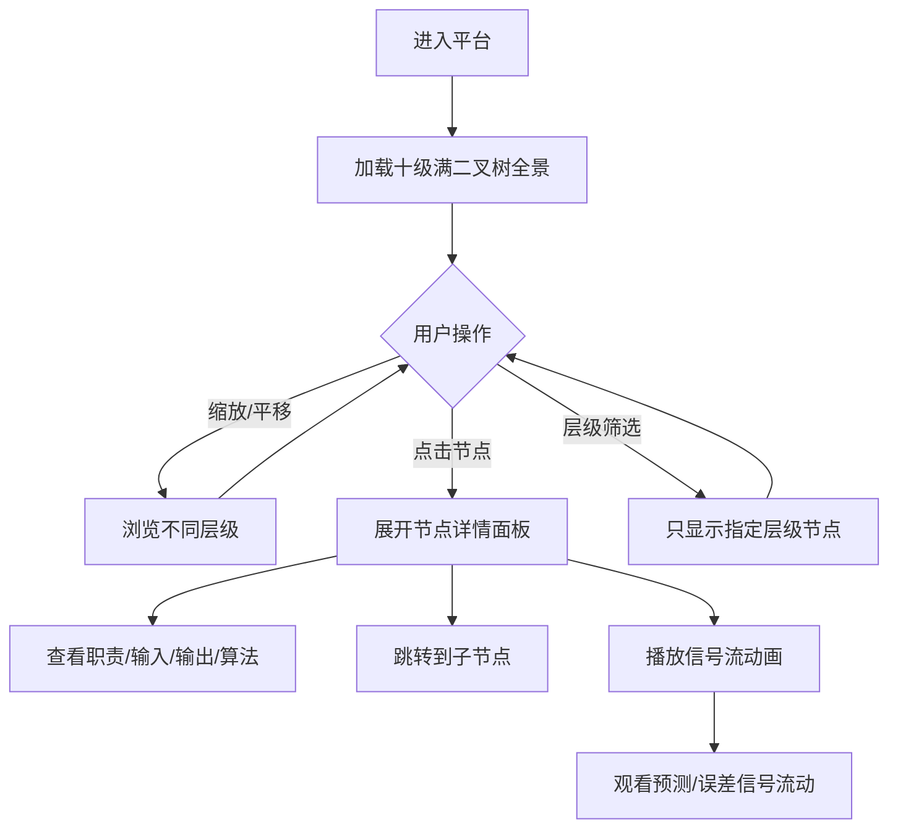

## 1. 产品概述

基于第一性原理的十级满二叉树类脑Agent系统架构可视化平台，将2047个节点的类脑架构以交互式二叉树形式呈现。用户可逐层探索从全局预测-修正总循环到原子计算单元的完整类脑Agent设计，支持节点详情查看、层级导航与信号流动画演示。目标用户为AI架构师、认知科学研究者和系统设计师。

## 2. 核心功能

### 2.1 用户角色
| 角色 | 访问方式 | 核心权限 |
|------|----------|----------|
| 访客 | 无需注册 | 浏览二叉树、查看节点详情、播放信号流 |

### 2.2 功能模块
1. **全景视图页**：十级满二叉树可视化画布、缩放/平移导航、层级筛选器
2. **节点详情页**：节点职责/输入/输出/算法详情、左右子节点跳转、文档下载
3. **信号流演示页**：预测-修正信号沿树流动的动画、速度控制、路径高亮

### 2.3 页面详情
| 页面名称 | 模块名称 | 功能描述 |
|----------|----------|----------|
| 全景视图页 | 二叉树画布 | 使用D3.js渲染2047节点树，支持缩放/拖拽/折叠 |
| 全景视图页 | 层级筛选器 | 按层级1-10筛选显示节点，高亮当前选中层级 |
| 全景视图页 | 迷你导航图 | 右下角缩略图，显示当前视口位置 |
| 节点详情页 | 信息面板 | 展示节点名称、职责、输入输出、核心算法 |
| 节点详情页 | 子树预览 | 显示当前节点的子树结构（向下2层） |
| 信号流演示页 | 动画控制 | 播放/暂停/速度调节/循环模式 |
| 信号流演示页 | 路径追踪 | 高亮信号从叶子到根或根到叶子的流动路径 |

## 3. 核心流程

用户进入平台后，首先看到十级满二叉树的全景视图，根节点"全局预测-修正总循环"位于顶部中央。用户可以通过鼠标滚轮缩放、拖拽平移来浏览不同层级的节点。点击任意节点后，右侧滑出详情面板，展示该节点的完整设计文档。用户可以通过详情面板中的"查看子树"按钮聚焦到该节点的子树，或通过"播放信号流"观看预测信号和误差修正信号在树中的流动动画。

## 4. 用户界面设计

### 4.1 设计风格
- **主色调**：深空黑 `#0a0a0f` 作为背景，营造大脑神经网络的深邃感
- **辅助色**：电光蓝 `#00d4ff` 代表预测分支，霓虹粉 `#ff006e` 代表误差修正分支
- **按钮样式**：扁平化带微光边框，hover时发出对应分支颜色的辉光
- **字体**：标题使用等宽字体 JetBrains Mono 营造科技感，正文使用思源黑体
- **布局风格**：全屏沉浸式画布，左侧层级导航栏，右侧可折叠详情面板
- **图标风格**：使用 lucide-react 的神经网络/节点相关图标

### 4.2 页面设计概述
| 页面名称 | 模块名称 | UI元素 |
|----------|----------|--------|
| 全景视图页 | 二叉树画布 | 节点为圆形，预测分支左子节点蓝色渐变，误差分支右子节点粉色渐变，连线为贝塞尔曲线带流动粒子 |
| 全景视图页 | 层级筛选器 | 左侧垂直排列1-10层级按钮，当前层级高亮 |
| 全景视图页 | 迷你导航图 | 右下角200x150缩略图，视口框为半透明黄色 |
| 节点详情页 | 信息面板 | 右侧400px宽滑出面板，毛玻璃背景，分区展示职责/输入/输出/算法 |
| 节点详情页 | 子树预览 | 面板底部小型树状图，可点击跳转 |
| 信号流演示页 | 动画控制 | 底部悬浮控制条，播放/暂停/速度滑块/循环开关 |
| 信号流演示页 | 路径追踪 | 信号经过的节点和连线高亮发光，带粒子流动效果 |

### 4.3 响应式设计
- 桌面端优先，画布占据全屏
- 移动端：左侧层级导航变为底部横向滚动条，右侧面板变为全屏模态框

### 4.4 动画与交互
- 节点hover：放大1.2倍，外圈发光
- 节点点击：脉冲扩散动画，详情面板滑入
- 信号流动：沿贝塞尔曲线移动的粒子，带拖尾效果
- 层级切换：节点淡入淡出，连线重新绘制
- 页面加载：从根节点向下逐级展开动画
