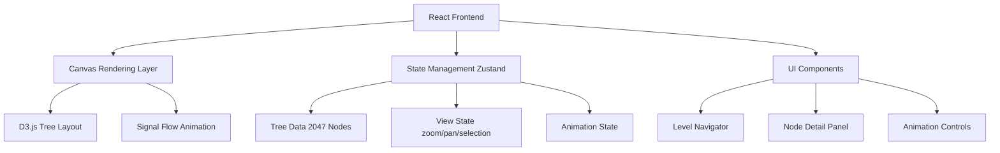

## 1. 架构设计



## 2. 技术描述

- **前端**: React@18 + TypeScript + Vite + TailwindCSS
- **可视化**: D3.js@7 用于二叉树布局与SVG渲染
- **状态管理**: Zustand 管理树数据、视图状态、动画状态
- **动画**: CSS Animations + D3 Transitions + requestAnimationFrame 粒子系统
- **初始化工具**: vite-init (react-ts 模板)

## 3. 路由定义

| 路由 | 用途 |
|------|------|
| / | 主页面，包含全景画布、导航、详情面板 |

单页应用，所有交互通过状态切换在主页完成。

## 4. 数据结构

### 4.1 节点类型定义

```typescript
interface TreeNode {
  id: string;           // L{level}-{index}-{name}
  level: number;        // 1-10
  index: number;        // 该层内的序号
  name: string;         // 节点名称
  responsibility: string; // 核心职责
  inputs: string[];     // 输入信号
  outputs: string[];    // 输出信号
  algorithm: string;    // 核心算法
  leftChild?: string;   // 左子节点ID
  rightChild?: string;  // 右子节点ID
  parent?: string;      // 父节点ID
  branch: 'prediction' | 'error' | 'root'; // 所属分支
}
```

### 4.2 视图状态

```typescript
interface ViewState {
  scale: number;        // 缩放比例
  translateX: number;   // 平移X
  translateY: number;   // 平移Y
  selectedNodeId: string | null;
  highlightedLevel: number | null;
  focusedSubtreeRoot: string | null;
}
```

### 4.3 动画状态

```typescript
interface AnimationState {
  isPlaying: boolean;
  speed: number;        // 0.5x - 3x
  mode: 'prediction' | 'error' | 'both';
  loop: boolean;
  activePaths: string[][]; // 高亮路径
}
```

## 5. 组件架构

| 组件 | 职责 | 位置 |
|------|------|------|
| TreeCanvas | D3树渲染、缩放平移、节点交互 | src/components/TreeCanvas.tsx |
| TreeNode | 单个节点渲染（圆形+文字） | src/components/TreeNode.tsx |
| TreeLink | 节点间连线（贝塞尔曲线） | src/components/TreeLink.tsx |
| Particle | 信号流动粒子 | src/components/Particle.tsx |
| LevelNavigator | 左侧层级筛选 | src/components/LevelNavigator.tsx |
| NodeDetailPanel | 右侧节点详情 | src/components/NodeDetailPanel.tsx |
| MiniMap | 右下角缩略图 | src/components/MiniMap.tsx |
| AnimationControls | 底部动画控制条 | src/components/AnimationControls.tsx |
| SignalFlowDemo | 信号流演示模式 | src/components/SignalFlowDemo.tsx |

## 6. 性能优化

- 虚拟渲染：只渲染视口内节点（2047节点全部渲染会卡顿）
- 节点聚合：缩放较小时，将子树聚合为单节点
- 使用 useMemo/useCallback 避免不必要的重渲染
- D3 数据绑定使用 key 函数避免全量更新
- 粒子系统使用 Canvas 而非 SVG 以提高性能
